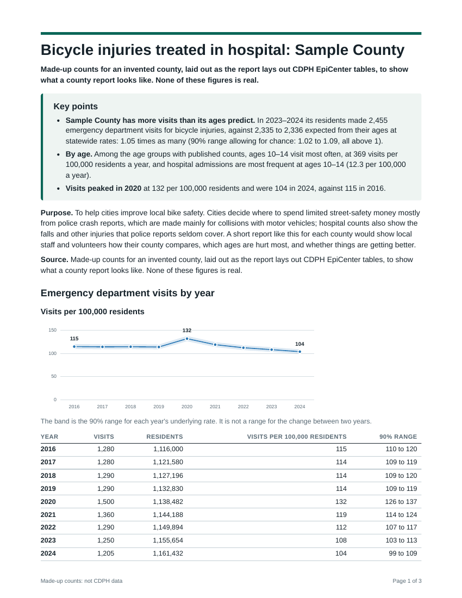
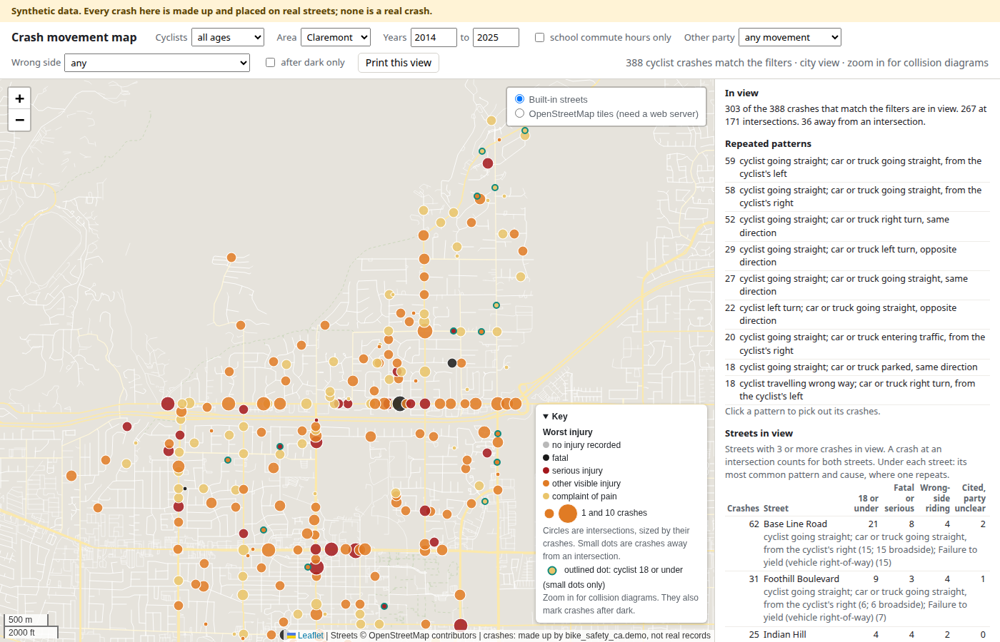
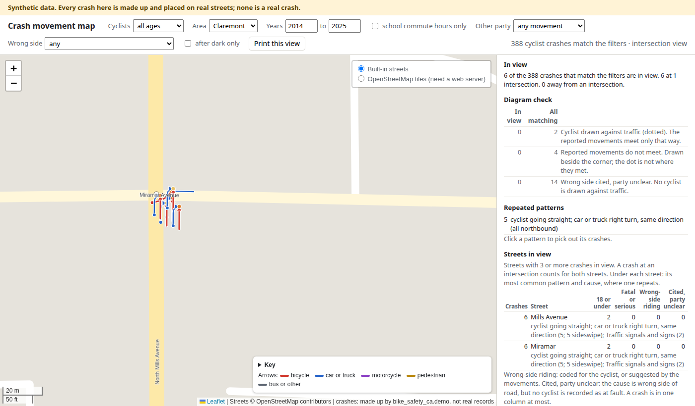
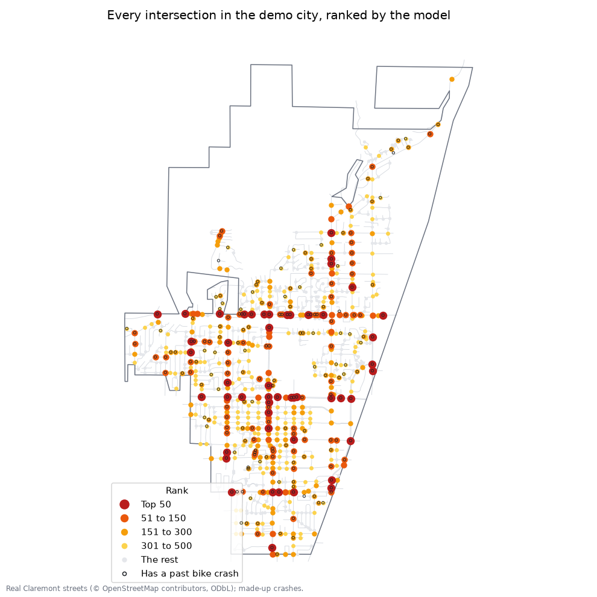

# bike-safety-ca

**How often people on bikes end up in hospital in a California county, where
the crashes were, and where to look next.**

bike-safety-ca turns public records (state hospital counts, police crash
reports and OpenStreetMap) into three things a city can use:

1. **[A county hospital report](#a-county-hospital-report):** emergency room
   visits for bicycle injuries set against the state, and hospital admissions
   by age.
2. **[An interactive crash map](#an-interactive-crash-map):** where police
   recorded bike crashes, how each happened, and what keeps happening.
3. **[A ranking of where to look next](#a-ranking-of-where-to-look-next):**
   intersections and streets ordered by where bike crashes are most likely,
   from a model tested on 28 cities.

**Who it is for:** city traffic staff, bike and pedestrian commissions, and
advocates who need to show how big the problem is, where it is, and where to
look first.

**Status: a work in progress.** This is a working tool, not a finished,
polished product: expect rough edges, commands and outputs that may change,
and gaps in the documentation. It has been run on 28 California cities. The
Los Altos case study is written up in full; the others are recorded as
cross-city tests.

The pictures below come from made-up data (a demo city on real Claremont
streets, and an invented county), so they can be shown freely. A map made
from your own records shows real people's crashes and stays private (see
[Keeping records private](#keeping-records-private)).

## A county hospital report

A short PDF for one county, from the state's EpiCenter tables: emergency room
visits for bicycle injuries by year, and visits and admissions by age group
over the same years, with rates per resident. The county's visits are set
against what California's rates would give once its residents' ages are
allowed for. Counts under 11 stay hidden, as the state requires. A separate
statewide report compares injuries on electric bicycles with other bicycles.

[](docs/demo/hospital_sample.pdf)

*Page 1 of the sample report: the real report code on made-up counts for an
invented county. All three pages:
[`docs/demo/hospital_sample.pdf`](docs/demo/hospital_sample.pdf).*

The counts are by where the injured person lives, not where they were hurt,
count visits and admissions rather than people, and say nothing about
streets.

## An interactive crash map

[](https://geoff-davis.github.io/bike-safety-ca/demo/crash_movement_map.html)

A single-file map of the bike injury crashes police recorded (from TIMS and
the state's crash records) that can be placed on the map. Zoomed out, each
intersection is a circle sized by its crashes and coloured by the worst
injury. Filter by the cyclist's age, the years, what the other party was
doing, wrong-side riding and darkness, and print any view for a meeting.

The side panel lists the crash patterns that repeat among the crashes in
view (a right hook counts as one pattern from any direction); clicking one
picks out its crashes. Its "Streets in view" table sums up the streets with
three or more crashes in view: how many crashes, how many involved a cyclist
18 or under, a fatal or serious injury or wrong-side riding, and the pattern
and cause that repeat most along the street. Tables of totals by year,
cause, time of day and age come with it.

Zoom in on a corner and each crash is drawn as the movements of the people
in it. At this demo corner, five of six crashes are the same right hook: a
cyclist going straight north and a car turning right across them.



[Open the demo map](https://geoff-davis.github.io/bike-safety-ca/demo/crash_movement_map.html) in a browser. It is one file,
[`docs/demo/crash_movement_map.html`](docs/demo/crash_movement_map.html) in
the repository, and works offline once downloaded.

Before comparing years, a reporting check flags police departments whose
crash counts rose or fell abruptly. A flag is not proof, since real crashes
can fall too, but it says which changes to look into before reading them as
a change in safety.

## A ranking of where to look next

Bike crashes are rare, so a few years of records miss many of the places
where the next ones happen: in the twelve cities compared, between a quarter
and 70% of later bike crashes, depending on the city and window, were at
corners with no bike crash on record. The model ranks
every intersection, and the city's named streets, by the bike crashes police
are likely to record there, including those corners. It needs no traffic
counts: car and bike crash records stand in for traffic. Where a city has
fewer than 100 bike crashes, or the model cannot be fitted, a simpler
ordering is used instead; it ranks the corners but does not estimate their
crash counts.



*The demo city ranked by the model. Rings mark corners with a past bike
crash; many highly ranked corners have none.*

It was tested the way it would be used: built from earlier years of crashes
and scored on the crashes that came after, in 28 California cities from San
Diego and San Jose to Davis and South Lake Tahoe. In the 27 with enough
crashes to score, it beat ranking by past crashes alone in every one. The
score is the AUC (area under the ROC curve): the chance that a corner with a
later bike crash is ranked above one without, where 0.5 is a coin toss and
1.0 is perfect. It averaged 0.85 across the 27 cities, and ranged from 0.74
in East Palo Alto, a small city with too few crashes to fit the full model,
to 0.90 in Irvine.

It does best in spread-out cities built on arterials, where bike crashes
follow car traffic: in San Jose and Sacramento the 100 corners it ranked
highest held about 35% more of the later crashes than the 100 with the most
past crashes. It does least well in small cities with few crashes, and for
children outside the large cities.

These are retrospective tests: the later years were seen while the model was
being built, and about 100 variants were tried on the same overlapping
windows. Read them as a guide to where the ranking can be trusted, not as a
measured accuracy. [Where the ranking helps most and
least](docs/where_the_ranking_helps.md) gives the results city by city, and
[what the score does and does not tell you](docs/where_the_ranking_helps.md#what-the-rank-score-does-and-does-not-tell-you) explains what an AUC can
and cannot show here.

## What it does not tell you

What is ranked is expected police-recorded bike crashes, not risk per rider.
A corner can rank high because many people cycle through it, and a crash the
police never recorded does not count. The ranking says where to look first.
It does not say which route is safest or what a change to a street would do;
that is for an engineer who has looked at the place.

## A worked example: Los Altos

Los Altos is where this started. [The case study](docs/case_study_los_altos.md)
runs every step on the city and the two miles around its schools, with every
setting written down and the expected results kept in `case_studies/`, so it
can be run again and checked.

## Try it without any data

```bash
uv sync
make walkthrough
```

This opens a notebook that runs every step on a demo city: real streets
(Claremont, from OpenStreetMap) and made-up crashes, all labelled as
synthetic. Because the demo knows each corner's true crash rate, the notebook
can score the ranking against the truth.

## Using it for your city

You need Python, [uv](https://docs.astral.sh/uv/) and a free account at
[TIMS](https://tims.berkeley.edu) for the crash exports. The rest downloads
itself: newer crash records from the state's open data portal, streets from
OpenStreetMap, city limits and residents from the Census Bureau.

1. Copy a city's file in `config/` and change the county, cities and years.
2. Build the area and its streets.
3. Export your area's crashes from TIMS and build the crash tables.
4. Run the reporting check before comparing years.
5. Run the hold-out test and the ranking.
6. Make the summaries, the corridor table and the crash map.

[The guide](docs/guide.md) gives the command for each step and what it
writes. The hospital report needs only the county's name; see its section in
the guide.

## Keeping records private

No crash, party or victim record is kept in this repository, and its tests
use made-up data. What you build from real records stays on your computer,
under `data/` and `output/`. Tables of totals can be published with the
sources' credits. The crash map draws one real person's crash at a time:
share it privately with the city's traffic staff and do not publish it.

The hospital downloader opens the state's EpiCenter site in a browser window
and waits for you to read its user agreement and click "I Agree" yourself; it
never accepts the agreement for you. By default it pulls only the six tables
the reports need. Hidden counts (under 11) are never worked out from
other figures, and every chart credits the California Department of Public
Health.

Read [Crash records](docs/guide.md#crash-records) in the guide before using
real records. It covers the sources' terms, what may be published, and the
limits on using the data near a lawsuit.

## More

- [Guide](docs/guide.md): every command, from the demo to your own records.
- [Where the ranking helps most and least](docs/where_the_ranking_helps.md):
  the cross-city tests.
- [How the ranking works](docs/crash_history_method.md): the argument for
  the model and the tests of it.
- [How counties are compared](docs/county_rates_method.md): the hospital
  report's method.
- [Case study: Los Altos](docs/case_study_los_altos.md).

## Development

`make check` runs lint, type checks and tests (the slow tests only with
`make test-all`, which CI runs). `make hooks` installs the git hooks.

## Licence

MIT for the code. See `LICENSE`.

`demo/claremont/streets.json.gz` is OpenStreetMap data, © OpenStreetMap
contributors, under the Open Database License 1.0, and is not covered by the
MIT licence. `demo/claremont/README.md` lists the source of each demo map file.
